# Casino World: complete documentation

Reference for version 0.6.3, taken from the source code.

Generated from the separate pages by `tools/build_docs.py`; edit those, not this file.

---

## Contents

**Playing**
- [Getting started](#page-getting-started)
- [Casinos](#page-casinos)
- [Games](#page-games)
- [Video slots](#page-video-slots)
- [Crates](#page-crates)
- [The club](#page-club)

**The Gambler class**
- [How the class works](#page-gambler-class)
- [Weapons](#page-weapons)
- [Armour](#page-armor)
- [Upgrade Machine](#page-upgrade-machine)
- [Accessories](#page-accessories)

**World**
- [Enemies](#page-enemies)
- [Bosses](#page-bosses)
- [High Stakes Night](#page-high-stakes-night)
- [NPCs](#page-npcs)

**Reference**
- [All items](#page-items)
- [Settings and multiplayer](#page-settings)
- [Development](#page-development)

---

## Conventions
- Use times are in ticks (60 ticks = 1 second).
- Enemy stats are Normal mode values. Vanilla Expert and Master scaling applies unless a page says otherwise.
- Coin amounts use p / g / s / c for platinum, gold, silver and copper.
- DPS figures come from the project's own calculation model unless a page says they were measured in game.

---

## Getting started

### Your first items
-  **Casino Blueprint**: builds the surface casino where you point. It is reusable: using it again moves the casino. New characters start with one, and existing characters receive one when they enter a world. It can also be crafted from 25 Wood at a Work Bench or bought from the Gambler.
-  **Gambler's Handbook**: an eight-page in-game guide. New characters start with one, and the Prize Cashier sells it for 10 silver.

### Building the casino
Hold the blueprint and point at the ground. A green preview means the site is valid, red means it is not. The site needs solid ground under at least half of the foundation, and no chests, liquid or protected structures in the space that gets cleared. There is one surface casino per world.

### Entering and leaving
Stand at the door and press Up (W by default). The interior is a separate dimension. It is rebuilt on every visit, but your character, coins and items are saved as usual, so losses are real. You return to the place you came from.

The doors stay closed while a boss is alive or during an invasion, Pumpkin Moon, Frost Moon, solar eclipse or Old One's Army event.

### Loyalty Tokens
 Each round you bet on pays **Loyalty Tokens**, win or lose: 1 for a bet below 1 gold, 5 from 1 gold and 10 from 1 platinum. Doubling down or splitting in blackjack counts as another round. Spend tokens at the [Prize Cashier](#npcs--prize-cashier) and in crafting recipes.

### Becoming a Gambler
1. Craft a **Lucky Penny** (8 copper or tin bars and 5 tokens), or win a weapon from a casino jackpot or a [crate](#page-crates).
2. Read [how the class works](#page-gambler-class).
3. Check that the **All In** key (V by default) is bound in Settings > Controls > Mod Controls.

### Suggested route
| Stage | Goals |
|---|---|
| Early game | Build the casino, collect Lucky Crates from chests, get the Gambler set |
| After Skeletron | Fight [The Wild Card](#bosses--the-wild-card) |
| Early hardmode | Follow the chat message to the High Rollers casino, craft the High Roller set at the [Upgrade Machine](#page-upgrade-machine) |
| After a mechanical boss | Fight [The Pit Boss](#bosses--the-pit-boss), survive [High Stakes Night](#page-high-stakes-night) |
| After Plantera and the Moon Lord | Tier 3 and 4 weapons from jackpots and crates, Spectral and Celestial sets |

---

## Casinos

| | Surface casino | High Rollers casino |
|---|---|---|
| Opens | When you use the Casino Blueprint | Automatically in hardmode |
| Location | Where you build it | Underground, at least 250 tiles from spawn; a chat message gives distance, direction and depth |
| Chips | 1s, 10s, 1g, 5g | 1g, 10g, 50g, 1p |
| Maximum bet per round | 20g | 5p |
| Stake needed for any jackpot item | 10s | 1g |
| Stake for the full jackpot chance and the second token | 1g | 10g |
| Slots | Classic slot machines, Angler's Bonanza | Video slots |
| Arcade (Plinko, Slime Derby, Higher or Lower) | Ground and bar floor | Bar floor |
| Upgrade Machine | No | Yes |
| Boss fight | No | [The Pit Boss](#bosses--the-pit-boss) |

If no underground site is found, the game tries again every five minutes. [High Roller Crates](#page-crates) are scattered through the caverns when the casino opens.

### Floors
Both casinos share one layout: a three-storey hall, 150 tiles wide and about 22 tiles high per floor, connected by elevators.

- **Ground floor:** lobby with the fountain, prize counter, roulette, blackjack, slots, the Fortune Wheel and, in the High Rollers casino, the Upgrade Machine.
- **Bar floor:** the bar (drinks and Sic Bo), tables and a row of ten slot machines.
- **Cabaret:** stage show, pole stage, tables and three slot machines.

The surface casino is cream marble, emerald damask and purple velvet. The High Rollers casino is black marble, midnight velvet and LED panels.

### Jackpot items
Big wins can drop an item. The chance scales with the stake up to the full stake; smaller stakes than the minimum never drop anything.

| Win | Chance at full stake |
|---|---|
| Roulette, straight number | 25% |
| Blackjack, natural | 12% |
| Slots, three Bars, Sevens or Diamonds | 100% |
| Slots, any other three of a kind | 15% |
| Video slot win of 15x or more | 50% |
| Video slot win of 50x or more | 100% |
| Sic Bo, total win of at least 20 times the stake | 100% |
| Arcade win of 10x / 20x / 100x or more | 10% / 20% / 100% |

| Casino and stage | Pool |
|---|---|
| Surface | Loaded Dice, Deck of Cards, High Roller, Gambler set pieces, Four-Leaf Clover, Ace Up the Sleeve |
| High Rollers, hardmode | Snake Eyes, Royal Flush, Jackpot Cannon |
| High Rollers, after Plantera | Ace of Spades, Doubling Dice, Roulette Revolver |
| High Rollers, after the Moon Lord | Stardust Deck, Meteor Dice, Infinity Slot |

### House rules
- The interior cannot be mined, built on or blown up.
- Time, natural enemy spawns and events are off.
- Boss and event summons do not work inside, except the Vault Key in the High Rollers casino.
- A leaderboard shows the biggest wins today, in the last seven days and of all time, shared by everyone in the world.

---

## Games

Payouts are net winnings per unit staked unless noted. Bet limits are on the [Casinos](#page-casinos) page.

### Roulette
European wheel, single zero. Every bet has a house edge of 2.70%.

| Bet | Pays |
|---|---|
| Straight (one number) | 35 to 1 |
| Split (two numbers) | 17 to 1 |
| Corner (four numbers) | 8 to 1 |
| Dozen, column | 2 to 1 |
| Red, black, odd, even, 1-18, 19-36 | 1 to 1 |

Click a field to place a chip, right-click to take it back. Put chips on a line for a split or on a corner for four numbers. Zero loses the outside bets.

### Blackjack
- Six decks, dealer stands on all 17s
- Blackjack pays 3 to 2
- Double on any first two cards, also after a split
- One split per round; split aces get one card each

Against perfect basic strategy the house edge is roughly 0.5%.

### Sic Bo
Three dice, played with the Bartender.

| Bet | Pays | House edge |
|---|---|---|
| Small (4-10), Big (11-17), Odd, Even | 1 to 1, loses on any triple | 2.8% |
| Single number | 1, 2 or 3 to 1 for one, two or three dice | 7.9% |
| Any triple | 30 to 1 | 13.9% |

### Classic slots
Three reels with 32 stops each. Return to player is 100.92%, slightly in your favour. 18.4% of spins make a profit, and 37.1% return at least the bet.

| Symbol | Stops per reel | Three of a kind (total return) | Pair on reels 1-2 (total return) |
|---|---|---|---|
| Cherry | 8 | 7x | 2x |
| Lemon | 7 | 10x | 2x |
| Bell | 6 | 15x | 2x |
| Clover | 5 | 25x | 3x |
| Bar | 3 | 50x | 3x |
| Seven | 2 | 120x | 4x |
| Diamond | 1 | 400x | 5x |

A single cherry on the first reel returns the bet.

### Video slots
See [Video slots](#page-video-slots).

### Plinko
A chip falls through 12 rows of pegs into one of 13 pockets. Up to six chips can fall at once.

| Risk | Pockets, edge to centre | Return |
|---|---|---|
| Low | 9x, 3x, 1.6x, 1.3x, 1.1x, 1x, 0.5x | 97.9% |
| Medium | 30x, 10x, 4x, 2x, 1.1x, 0.6x, 0.3x | 98.3% |
| High | 150x, 22x, 8x, 2x, 0.7x, 0.2x, 0.2x | 96.6% |

### Slime Derby
| Slime | Win chance | Total return |
|---|---|---|
| Greenie | 36% | 2.7x |
| Blue Bounce | 25% | 3.9x |
| Red Rocket | 18% | 5.4x |
| Purple Rain | 13% | 7.5x |
| Golden Goo | 8% | 12x |

### Higher or Lower
Guess whether the next card is higher or lower. Equal cards win, ace is low, king is high, and the deck is endless. Each right guess multiplies the pot by 0.98 / chance, capped at 100x. Cash out any time; a wrong guess loses everything. Every guess costs about 2%, so long streaks return less.

### Scratch cards
Sold by the Prize Cashier: Scratch Card (50s) and, in hardmode, Platinum Scratch Card (5g). Scratch nine fields; three of a kind wins a multiple of the card price. 34.9% of cards win, counting 1x returns, and the average return is 86%.

| Symbol | Prize | Chance |
|---|---|---|
| Cherry | 1x | 20% |
| Bell | 2x | 10% |
| Emerald | 5x | 4% |
| Lucky Coin | 20x | 0.8% |
| Large Diamond | 100x | 0.1% |

### Fortune Wheel
One free spin per real-world day. Twelve equal segments:

| Prize | Segments |
|---|---|
| 10 tokens | 4 |
| 15 tokens | 2 |
| 25 tokens | 3 |
| 50 tokens | 1 |
| 100 tokens | 1 |
| Lucky Crate | 1 |

### Daily challenges
The Prize Cashier offers three challenges per in-game day, separately for each character. New ones arrive at dawn, or after 24 minutes spent inside casinos, where the clock stands still. Completing all three also pays a Lucky Crate, or a High Roller Crate in hardmode.

| Challenge | Target | Tokens |
|---|---|---|
| Win blackjack hands | 3 | 40 |
| Win roulette rounds | 5 | 40 |
| Win slot spins | 8 | 35 |
| Place bets | 20 | 25 |
| Land Gambler jackpots in combat | 25 | 35 |
| Defeat casino enemies | 20 | 40 |
| Trigger a video slot bonus (hardmode) | 1 | 60 |
| Open casino crates | 2 | 30 |

---

## Video slots

Click on the reels to skip a running animation.

Found in the High Rollers casino. Figures come from the project's simulator (`slotsim`) at the default payout setting.

| Machine | Return | Win chance per spin | Bonus chance | Average bonus |
|---|---|---|---|---|
| Gates of the Lunar Gods | 99.1% | 25.9% | 1 in 63 | 36.5x |
| Angler's Bonanza | 98.6% | 24.2% | 1 in 73 | 48.4x |
| Boreal Wilds | 99.4% | 45.1% | 1 in 62 | 34.0x |
| Blood Moon Hunter | 99.2% | 36.9% | 1 in 62 | 38.1x |

When a spin already shows one scatter fewer than needed, the remaining reels glow and spin longer.

### Gates of the Lunar Gods
6x5 grid, pays anywhere for 8 or more of a symbol. Wins tumble away and new symbols fall in. Multiplier orbs (2x-500x) are revealed by the Moon Lord's deathray; at the end of a winning tumble they add up and multiply the win.

Four or more Celestial Sigils give 15 free spins. Orbs land 2.5 times as often and feed a total multiplier that grows for the whole bonus. Three or more sigils add 5 spins.

### Angler's Bonanza
5x3 grid, 10 lines. Fish carry cash values from about 0.06x to 11.5x the bet.

Three, four or five Golden Crates give 10, 15 or 20 free spins with the Angler wild, who collects the cash of every fish on screen. Every four Anglers add 10 spins and raise the collect multiplier to 2x, 3x and 10x. If fish are on screen without an Angler, he jumps in 1 time in 5.

### Boreal Wilds
5x4 grid, 20 lines. Three Frozen Crates start a lottery between four bonuses:

| Animal | Spins | Effect |
|---|---|---|
| Penguin | 12 | Walking 2x wilds step one reel left every spin |
| Snow Flinx | 12 | 1-3 snowballs per spin turn cells into wilds |
| Wolf | 10 | Sticky wilds |
| Ice Golem | 10 | A middle reel freezes fully wild every spin, wins pay 2x |

### Blood Moon Hunter
5x3 grid, 243 ways. The Hunter wild on reels 2-5 carries 1x, 2x or 3x. Blood Shot (1 in 16 base spins, 1 in 5 free spins) fires 3-6 shots that turn cells wild.

Three, four or five Blood Moons give 10, 12 or 15 free spins. Every three wilds collected turn the lowest symbol into a premium and add 2 spins, up to four times.

---

## Crates

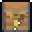 **Lucky Crate** and 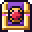 **High Roller Crate**. Right-click to open: a reel spins and stops on the prize. Contents follow the world's progress at the moment of opening.

| Rarity | Lucky | High Roller | Contents |
|---|---|---|---|
| Common (blue) | 58% | 45% | Supplies: potions, coins, tokens, materials |
| Uncommon (purple) | 25% | 30% | Useful vanilla gear, coins, tokens |
| Rare (pink) | 10% | 15% | Gambler accessories, luxury, vanity |
| Epic (red) | 6% | 8% | Gambler weapons, and Gambler armour before hardmode |
| Legendary (gold) | 1% | 2% | A golden Gambler weapon, the Gamblorghini, wings or platinum |

**Pity:** the tenth crate in a row without Rare or better gives Rare. The 25th without Epic or better gives Epic. The 80th without Legendary gives Legendary. The counters are saved with the character.

**Golden weapons** deal 10% more damage and have a gold look. The bonus stacks with reforges and upgrades.

### Notable contents
| Stage | Rare | Epic | Legendary |
|---|---|---|---|
| Early | Four-Leaf Clover, Ace Up the Sleeve, Golex, Top Hat, Sunglasses | Loaded Dice, Deck of Cards, High Roller, Gambler set | Golden versions, Gamblorghini, 1p |
| After Skeletron | As early, with the Wild Card Mask and Golden Chip instead of the vanity | Also Jackpot Lever, Dealer's Hand, Wheel of Fortune | Golden versions, Gamblorghini, 1-2p |
| Hardmode | Clover, Ace, Golex, Titan Glove, High Roller's Ring, Martingale Medallion | Snake Eyes, Royal Flush, Jackpot Cannon | Golden versions, Gamblorghini, 2-3p |
| After Plantera | Destroyer Emblem, Ring, Medallion and the base accessories | Ace of Spades, Doubling Dice, Roulette Revolver | Golden versions, Royal Flush Wings, Gamblorghini, 3-5p |
| After the Moon Lord | Celestial Shell, Ring, Medallion and the base accessories | Stardust Deck, Meteor Dice, Infinity Slot | Golden versions, Royal Flush Wings, Gamblorghini, 8-12p |

### Where to find them
- In newly generated worlds, every vanilla chest holds a Lucky Crate. Gold and locked dungeon chests hold two, one time in four. Chests in existing worlds are left alone.
- Lucky Crates lie on cave floors, and High Roller Crates are scattered through the caverns when the High Rollers casino opens.
- Fishing: a crate catch becomes a casino crate 1 time in 5 (in hardmode a third of those are High Roller). Any other catch is a Lucky Crate 1 time in 80.
- Drops from casino [enemies](#page-enemies) and [bosses](#page-bosses), daily challenges, the Fortune Wheel.
- Prize Cashier: 75 tokens (Lucky), 150 tokens (High Roller, hardmode).
- The Gambler NPC:

| Stage | Lucky Crate | High Roller Crate |
|---|---|---|
| Early | 2g 50s | |
| After Skeletron | 3g 50s | |
| Hardmode | 7g | 8g |
| After Plantera | 15g | 17g |
| After the Moon Lord | 48g | 52g |

---

## The club

### Gambler's Ledger
 Every character gets one; the Prize Cashier sells more. Five pages: statistics (overall and by game), achievements, contracts, the VIP club and [Fates](#gambler-class--fates). Everything belongs to the character.

### Achievements
Thirty-three goals that pay 10 to 200 Loyalty Tokens once each: rounds played, money bet and won, streaks, every game, crates, jackpots in combat, daily challenges, the three bosses, the penthouse and the Diamond level.

### Contracts
Handed out and paid by the Concierge, one at a time. The first time a contract pays tokens and one item of your choice, after that half the tokens. They are a sure way to the weapons that otherwise depend on luck.

| Contract | Needs | Task | Tokens | One of |
|---|---|---|---|---|
| Lost Shipment | | Follow the arrow into the caverns, beat 6 in an ambush | 60 | Loaded Dice, Deck of Cards, High Roller |
| House Rules | | Win 3 roulette, 3 blackjack and 5 arcade rounds | 50 | Gambler's Fedora, Vest, Shoes |
| Bad Debts | | Defeat 10 Broke Gamblers or Loan Sharks | 40 | Four-Leaf Clover, Ace Up the Sleeve |
| Cold Deck | | Ambushes of 6 in the snow and in the desert | 60 | Chip Chain Hook, Golex, 3 Lucky Crates |
| Jokers Wild | Skeletron | Defeat The Wild Card without dying | 80 | Jackpot Lever, Dealer's Hand, Wheel of Fortune |
| The Big Score | hardmode | 150 jackpot hits, then win 1p at the tables | 100 | Martingale Medallion, High Roller's Ring, Dealer's Visor |
| Hell's Ledger | hardmode | Ambush of 8 in the underworld | 100 | Snake Eyes, Royal Flush, Jackpot Cannon |
| Casino Security | mechanical boss | Defeat the Guard Captain | 120 | 12 Vault Bullion, 2 Vault Keys, 4 High Roller Crates |
| Vault Audit | mechanical boss | Go All In 5 times, then The Pit Boss without dying | 150 | Croupier's Rake, Bank Breaker, Vault Buster |
| Jungle Marker | Plantera | Ambush of 10 in the underground jungle, then open 3 crates | 150 | Ace of Spades, Doubling Dice, Roulette Revolver |
| Star Debt | Moon Lord | Ambush of 12 in space, then 300 jackpot hits | 250 | Stardust Deck, Meteor Dice, Infinity Slot |
| Fortune's Favor | Fortuna | Defeat Fortuna without dying | 300 | 18 Fate Shards |

Steps count in order. An ambush starts on arrival and comes up to four enemies at a time.

### VIP levels
Sold by the **Concierge** on the ground floor, one after another.

| Level | Price | From | Perks |
|---|---|---|---|
| Silver | 1p | any time | Badge over the head in casinos, a drink (food buff) at every visit, furniture catalogue |
| Gold | 5p | hardmode | Limits x2 |
| Platinum | 20p | after Plantera | Limits x3, Penthouse Key for sale |
| Diamond | 75p | after the Moon Lord | Limits x5 |

The limits apply to roulette, blackjack, Sic Bo and the coin duel, the games with a house edge. Slots and arcade keep theirs.

### Furniture
The Concierge sells the casino's own furniture, wall decor and building materials (his shop button turns the catalogue). Furniture costs 8 gold per tile of size, at least 40 gold; floors 20 silver and wallpapers 10 silver each. The **Monument of Excess** costs 100 platinum and does nothing.

### Penthouse
The Penthouse Key (25p) takes you there from the main world and back. The loft is saved with the world, shared by everyone in it, and yours to build and furnish; only the outer shell and the door stay. No enemies, always night.

### Texas Hold'em
Bar floor. Fixed limit, four seats; free seats are played by the house's regulars. The small bet is the casino's second chip (10s on the surface, 10g at the High Rollers), the big bet twice that, at most three raises a street. Buy-in: 20 big bets. The house takes 5% of every pot that sees a flop, at most three big bets. Leaving takes your chips along and folds a running hand; so does a quit. Thirty seconds to act.

Measured over 30,000 hands against the regulars (`tools/pokersim`): calling everything loses 98 big bets per 100 hands, playing like a regular 11, careful play by the odds 6.

### Coin Duel
Cabaret floor. Offer a stake; another player matches it; the server tosses; the winner takes both, no fee and no tokens. Alone you can toss against the house for 1.96 times the stake.

---

## The Gambler class

Gambler weapons use their own damage class. It takes generic damage bonuses but never crits.

### Jackpot and Bust
| Roll | Base chance | Damage |
|---|---|---|
| Jackpot | 5% | x3 |
| Bust | 20% | x0.5 |
| Normal | 75% | x1 |

At these odds the average multiplier is exactly 1.0. Weapon tooltips show your current odds. Crit from vanilla reforges turns into half as much jackpot chance.

### Luck
Each point of Luck gives +1% jackpot and -2% bust. That is about +3% average damage per point up to Luck 10, where bust reaches zero, then +2% per point. Luck can raise the jackpot chance to at most 50%.

### The Pot
Hits fill the Pot: 1 point, 2 for a bust, 3 for a jackpot. It holds 100, and drains after three seconds without a hit unless it is full. Side hits (coins, embers, wall blasts) do not fill it. Dying empties it.

The meter sits at the top centre of the screen. Drag it with the inventory open, right-click it to reset, or place it under your character in the [settings](#page-settings).

### All In
With a full Pot, press the All In key (**V** by default). A shockwave hits everything within 15 tiles for three times your weapon's damage, and the dealer deals a hand:

| Hand | Chance | Jackpot bonus | Extra bust | Duration |
|---|---|---|---|---|
| Pair | 45% | +20% | +10% | 5 s |
| Two Pair | 25% | +25% | +10% | 5 s |
| Three of a Kind | 15% | +25% | +10% | 6 s |
| Full House | 9% | +30% | none | 6 s |
| Four of a Kind | 4.5% | +35% | none | 7 s |
| Royal Flush | 1.5% | +45% | none | 8 s |

When it ends, 10% of the damage you dealt is paid out as a blast (at most six times your weapon's damage, no jackpot roll). The Pot does not fill while All In runs. In the project's model All In adds roughly 15-17% damage over a long fight.

### Jackpots in a row
Consecutive jackpots raise the pitch of the sound. Three in a row trigger the Triple Jackpot: lights around the screen and a rain of coins, at most once per 20 seconds. It is visual only.

### Reforges
Any Gambler weapon can roll these in addition to vanilla prefixes.

| Prefix | Damage | Speed | Knockback | Jackpot chance |
|---|---|---|---|---|
| Lucky | +12% | +6% | | +4% |
| Rigged | +5% | | | +6% |
| Loaded | +15% | | +10% | |
| Shady | | +10% | | +2% |
| Cursed | -10% | | | -3% |
| Unlucky | | | | -4% |

### Fates
After Fortuna, on the Fates page of the Ledger. Each costs 15 Fate Shards once; one at a time is active, switching is free outside boss fights.

| Fate | Gives | Takes |
|---|---|---|
| Control | Normal hits +50% | Jackpots deal x2.25 instead of x3 |
| Dealer | Pot fills 50% faster, All In lasts 50% longer | -10% damage outside All In |
| Fool | Jackpots deal x3.1 | At least 12% busts; a bust costs 12 life, at most once a second |

Change in damage by jackpot chance (`tools/gambler_fates.py`, All In included):

| Jackpot chance | Control | Dealer | Fool |
|---|---|---|---|
| 10% | +17% | +2% | +1% |
| 18% | +11% | +1% | -1% |
| 24% | +5% | 0% | -1% |
| 35% | -4% | 0% | 0% |
| 41% | -7% | 0% | +1% |

Measured in game with Infinity Slot against 50 defense (average of two 30 s runs, about 10% noise each; the model leaves out defense):

| Build | No Fate | Control | Dealer | Fool |
|---|---|---|---|---|
| Celestial set only (18% jackpot, no All In) | 2,350 | 2,910 | 2,320 | 2,460 |
| Everything upgraded, 6 accessories, All In (41% jackpot) | 15,820 | 10,870 | 14,180 | 16,710 |

### Hot Streak
Gambler set bonus: after a jackpot, +10% Gambler damage for four seconds.

---

## Weapons

All weapons deal Gambler damage and can be upgraded at the [Upgrade Machine](#page-upgrade-machine). Use time is in ticks.

### Pre-hardmode
| | Weapon | Damage | Use time | Knockback | Source |
|---|---|---|---|---|---|
| 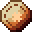 | Lucky Penny | 10 | 20 | 2 | 8 copper or tin bars, 5 tokens (Anvil) |
| 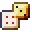 | Loaded Dice | 21 | 24 | 4 | Surface casino jackpots, crates |
|  | Deck of Cards | 9 x3 | 20 | 1.5 | Surface casino jackpots, crates, Card Soldier (1/80) |
|  | High Roller | 27 | 26 | 3 | Surface casino jackpots, crates |
| 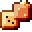 | Hellfire Dice | 24 x2 | 26 | 4 | 15 hellstone bars, 30 tokens (Anvil) |
| 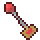 | Jackpot Lever | 26 | 26 | 7 | The Wild Card, crates after Skeletron |
|  | Dealer's Hand | 8 | 10 | 1 | The Wild Card, crates after Skeletron |
|  | Wheel of Fortune | 18 | 22 | 4 | The Wild Card, crates after Skeletron |

### Hardmode
| | Weapon | Damage | Use time | Knockback | Source |
|---|---|---|---|---|---|
|  | Snake Eyes | 36 | 24 | 5 | High Rollers jackpots, crates, Slot Mimic |
|  | Royal Flush | 16 x5 | 24 | 2 | High Rollers jackpots, crates, Slot Mimic, Royal Guard (1/60), Guard Captain (1/3) |
| 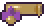 | Jackpot Cannon | 58 | 30 | 6 | High Rollers jackpots, crates, Slot Mimic |
|  | Croupier's Rake | 34 x3 | 24 | 4 | The Pit Boss |
|  | Bank Breaker | 25 x5 | 34 | 3 | The Pit Boss |
|  | Vault Buster | 56 | 30 | 6 | The Pit Boss |

### After Plantera
| | Weapon | Damage | Use time | Knockback | Source |
|---|---|---|---|---|---|
|  | Ace of Spades | 60 | 24 | 3 | High Rollers jackpots, crates |
|  | Doubling Dice | 46 | 28 | 4 | High Rollers jackpots, crates |
| 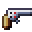 | Roulette Revolver | 30 | 16 | 2 | High Rollers jackpots, crates |

### After the Moon Lord
| | Weapon | Damage | Use time | Knockback | Source |
|---|---|---|---|---|---|
|  | Stardust Deck | 115 | 16 | 3 | High Rollers jackpots, crates |
| 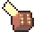 | Meteor Dice | 220 | 24 | 6 | High Rollers jackpots, crates |
| 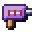 | Infinity Slot | 110 x2 | 12 | 3 | High Rollers jackpots, crates |

### What they do
| Weapon | Behaviour | Against walls and floors |
|---|---|---|
| Lucky Penny | A coin flip: heads splits into two half-damage coins on its first hit | Clinks and sparks |
| Loaded Dice | Bouncing die, pierces 3 | Up to 3 bounces; each rolls 1-6 and sets the damage (x0.75 to x1.25, 1.0 on average) |
| Deck of Cards | Fan of three cards | Sticks for about 1.5 s as a trap for half damage |
| High Roller | Ricochets to another enemy after a hit | One bank shot, turning to an enemy within a 45 degree cone |
| Hellfire Dice | Two dice, set enemies on fire | Two bounces, each leaves an ember for 25% damage |
| Jackpot Lever | Melee. Every third hit spins: fire, 6 healing, an explosion or Midas | |
| Dealer's Hand | Card stream, every eighth throw is a fan of seven | One skip, then 60% damage |
| Wheel of Fortune | Boomerang that explodes red or black when it returns; one at a time | One burst per throw: red 50% damage, black 35% with double knockback |
| Snake Eyes | Bouncing die that explodes | After its bounces it sticks as a mine, armed for about half a second |
| Royal Flush | Five homing cards; all five in one enemy complete the flush (bonus blast, 120% of a card's damage) | Burns up |
| Jackpot Cannon | Heavy chip, ricochets to two more enemies | Pays out two coins (20% each) |
| Croupier's Rake | Three rolling chips, pierce up to 3 hits | Raked back once for half damage, can hit the same enemy again |
| Bank Breaker | Five-chip shotgun | Each chip shatters into a coin (35%) |
| Vault Buster | Lobbed gold bar that bursts into six coins (30% each) | Slam blast, 40% damage |
| Ace of Spades | Homing spectral card, up to 3 hits | Passes through walls |
| Doubling Dice | Splits into two half-damage dice on its first hit | Splits too, for 70% of the usual halves |
| Roulette Revolver | Every sixth shot is a golden round with triple damage | The golden round explodes, 40% damage |
| Stardust Deck | Bursts into three homing cards (35% each); ignores 25 defense | Bursts too, for 70% of that |
| Meteor Dice | Calls a burning die onto the cursor; the impact and the large explosion each hit for full damage | Leaves three embers (1/8 damage) |
| Infinity Slot | Two reel symbols per shot; rarer symbols hit harder | See below |

#### Infinity Slot symbols
| Symbol | Damage | Against walls |
|---|---|---|
| Cherry | x0.7 | Splatters |
| Lemon | x0.85 | Splatters |
| Bell | x1.0 | Ringing blast, 35% |
| Clover | x1.15 | Bounces once |
| Bar | x1.5 | Two coins, 25% each |
| Seven | x1.8 | Explosion, 50% |
| Diamond | x2.2 | Three coins, 35% each |

### Estimated single-target DPS
Model values with typical set Luck and no reforges, upgrades or All In.

| Tier | Weapons | Vanilla weapons of the stage (average) |
|---|---|---|
| Early pre-hardmode | 59-70 | 65 |
| After Skeletron | 71-77 | 76 |
| Early hardmode | 130-151 | 134 |
| Pit Boss | 171-182 | |
| After Plantera | 195-205 | 193 |
| After the Moon Lord | about 1200 | 1186 |
| Fortuna | about 1,400 | |

#### Measured in game
30 s on one large target that stands still, 50 defense (Fortuna's), perfect aim. One run each, about 10% noise.

| Weapon | Celestial set only | +10, Lucky, golden, 5 accessories | the same with All In | 6 expert accessories | the same with All In |
|---|---|---|---|---|---|
| Stardust Deck | 1,870 | not remeasured | not remeasured | not remeasured | 10,310 |
| Meteor Dice | 2,720 | 7,990 | 9,370 | 9,130 | 12,710 |
| Infinity Slot | 2,940 | 8,130 | 10,440 | 10,850 | 15,520 |
| Ophanim | 2,580 | 8,490 | 11,280 | 11,310 | 13,790 |
| Dice of Destiny | 2,390 | 7,910 | 8,520 | 8,320 | 11,900 |
| Eye of Fortune | 2,370 | 8,240 | 12,300 | 11,120 | 14,470 |

Vanilla in the same test with the best reforges and six accessories: Zenith (Solar set) 22,970, S.D.M.G. (Vortex set, chlorophyte bullets) 5,430.

### Fortuna's weapons
All drop from Fortuna or are made from 18 Fate Shards at the Upgrade Machine.

| | Weapon | Damage | Use time | Effect |
|---|---|---|---|---|
| 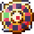 | Ophanim | 132 | held | A wheel stays at the cursor, saws every 8 ticks and throws a homing chip three times a second (50%) |
| 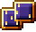 | Dice of Destiny | 190 | 22 | Two star dice that burst (65%); doubles burst wider (110%), a total of seven releases homing chips |
|  | Eye of Fortune | 132 | 9 | Instant piercing ray; every eighth shot is a triple |

---

## Armour

| Set | Stage | Defense | Luck (pieces + set) | Gambler damage |
|---|---|---|---|---|
| Gambler | Pre-hardmode | 12 | 4 + 3 | +5% |
| High Roller | Adamantite / titanium | 26 | 5 + 3 | +10% |
| Pit Boss | After a mechanical boss | 34 | 6 + 3 | +15% |
| Spectral | After Plantera | 46 | 7 + 3 | +20% |
| Celestial | After the Moon Lord | 76 | 10 + 3 | +36% |

Pieces can also be turned into the next set at the [Upgrade Machine](#upgrade-machine--turning-a-set-into-the-next). From the High Roller set on, crafting needs the Upgrade Machine.

### Gambler set
**Set bonus:** +3 Luck; jackpots start a Hot Streak (+10% Gambler damage for 4 s). Dropped by surface casino jackpots and crates; the Prize Cashier sells it for 60, 80 and 60 tokens.

| | Piece | Defense | Bonuses |
|---|---|---|---|
|  | Gambler's Fedora | 4 | +1 Luck, +5% Gambler damage |
|  | Gambler's Vest | 5 | +2 Luck |
|  | Gambler's Shoes | 3 | +1 Luck, +5% movement speed |

### High Roller set
**Set bonus:** +3 Luck; jackpots fill the Pot twice as much.

| | Piece | Defense | Bonuses | Recipe |
|---|---|---|---|---|
|  | Top Hat | 8 | +2 Luck, +4% damage | 12 adamantite or titanium bars, 60 tokens |
| 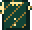 | Tailcoat | 11 | +2 Luck, +4% damage | 20 bars, 90 tokens |
| 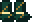 | Trousers | 7 | +1 Luck, +2% damage, +8% movement speed | 16 bars, 60 tokens |

### Pit Boss set
**Set bonus:** +3 Luck; All In deals a hand one rank better.

| | Piece | Defense | Bonuses | Recipe |
|---|---|---|---|---|
|  | Fedora | 10 | +2 Luck, +5% damage | 10 hallowed bars, 5 Vault Bullion, 80 tokens |
|  | Suit | 14 | +2 Luck, +5% damage | 16 hallowed bars, 8 Vault Bullion, 120 tokens |
|  | Shoes | 10 | +2 Luck, +5% damage, +8% movement speed | 12 hallowed bars, 6 Vault Bullion, 80 tokens |

### Spectral set
**Set bonus:** +3 Luck; jackpots release two homing spectral cards (40% of the hit each).

| | Piece | Defense | Bonuses | Recipe |
|---|---|---|---|---|
|  | Spectral Fedora | 14 | +2 Luck, +6% damage | 12 spectre bars, 100 tokens |
|  | Spectral Coat | 18 | +3 Luck, +8% damage | 18 spectre bars, 150 tokens |
|  | Spectral Loafers | 14 | +2 Luck, +6% damage, +8% movement speed | 14 spectre bars, 100 tokens |

### Celestial set
**Set bonus:** +3 Luck; jackpots call down a meteor die (60% of the hit).

| | Piece | Defense | Bonuses | Recipe |
|---|---|---|---|---|
|  | Celestial Fedora | 22 | +3 Luck, +12% damage | 8 luminite bars, 5 nebula and 5 stardust fragments, 200 tokens |
|  | Celestial Coat | 30 | +4 Luck, +14% damage | 16 luminite bars, 8 solar and 8 vortex fragments, 300 tokens |
|  | Celestial Loafers | 24 | +3 Luck, +10% damage, +12% movement speed | 12 luminite bars, 6 nebula and 6 stardust fragments, 200 tokens |

### Vanity
   White Fedora, White Tuxedo and White Spats from the Prize Cashier (60, 80 and 60 tokens).

---

## Upgrade Machine

Found on the ground floor of the High Rollers casino. Put a Gambler weapon or armour piece into the slot.

A failed try costs only the materials and the fee. The item never loses a level.

| | Per level | At +10 |
|---|---|---|
| Weapons | +3% damage | +30% damage |
| Armour | +1 defense, and +1 Luck at +5 and +10 | +10 defense, +2 Luck per piece |

A full set and a weapon at +10 deal about 1.41-1.45 times the damage of the same gear at +0.

| Upgrade | Material | Amount | Chance | Fee |
|---|---|---|---|---|
| +1 | Cobalt or palladium bars | 5 | 90% | 2g |
| +2 | Cobalt or palladium bars | 5 | 80% | 4g |
| +3 | Mythril or orichalcum bars | 5 | 70% | 6g |
| +4 | Mythril or orichalcum bars | 5 | 60% | 8g |
| +5 | Adamantite or titanium bars | 5 | 50% | 10g |
| +6 | Adamantite or titanium bars | 5 | 45% | 12g |
| +7 | Hallowed bars | 5 | 40% | 14g |
| +8 | Hallowed bars | 5 | 35% | 16g |
| +9 | Chlorophyte bars | 8 | 30% | 18g |
| +10 | Luminite bars | 5 | 25% | 20g |

**Boost** doubles the materials and adds 15% to the chance.

Items from +5 glow blue in the inventory, and gold at +10. A full set at +5 or better gives off sparks, gold at +10.

### Turning a set into the next
The **Next set** button turns an armour piece into the same piece of the next set. It never fails and keeps half of the levels, rounded down. Costs are head / body / legs.

| From | To | Bars | Vault Bullion | Tokens |
|---|---|---|---|---|
| Gambler | High Roller | 8 / 13 / 10 adamantite or titanium | | 40 / 60 / 40 |
| High Roller | Pit Boss | 7 / 11 / 8 hallowed | 4 / 6 / 4 | 50 / 80 / 50 |
| Pit Boss | Spectral | 8 / 12 / 9 spectre | | 70 / 100 / 70 |
| Spectral | Celestial | 6 / 11 / 8 luminite | | 130 / 200 / 130 |

---

## Accessories

| | Accessory | Effect | Source |
|---|---|---|---|
| 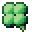 | Four-Leaf Clover | +2 Luck | Surface casino jackpots, crates |
|  | Ace Up the Sleeve | +3% jackpot chance | Surface casino jackpots, crates |
|  | House Edge (Expert) | +5% jackpot chance; the first bust every 10 s becomes a normal hit | The Wild Card treasure bag |
|  | Gambler Emblem | +15% Gambler damage | Wall of Flesh (1/5), or any of the Warrior, Ranger, Sorcerer or Summoner emblems and 30 tokens at a Tinkerer’s Workshop, or shimmering the Summoner Emblem |
|  | Dealer's Visor | +2 Luck, +3% jackpot chance | Prize Cashier, 250 tokens (hardmode) |
| 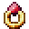 | High Roller's Ring | +2 Luck, +8% Gambler damage | Prize Cashier, 400 tokens (hardmode), crates |
| 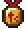 | Martingale Medallion | +2% jackpot chance for every hit without a jackpot, up to 75% in total; a jackpot resets it | Hardmode crates |
| 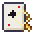 | Insider Info (Expert) | +6% jackpot chance, the Pot fills 30% faster | The Pit Boss treasure bag |
|  | Royal Flush Wings | Flight (time 160, speed 8), +1 Luck | 20 Souls of Flight, 10 ectoplasm, 400 tokens (Mythril Anvil); legendary crates |
| 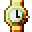 | Golex | Shows movement speed (works from the inventory) | Prize Cashier, 150 tokens; crates |
| 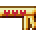 | Fortuna's Blindfold (Expert) | Every tenth gambler hit is a Jackpot | Fortuna treasure bag |

---

## Enemies

Normal mode base stats. "Spawn weight" multiplies the vanilla spawn condition named next to it. All have banners.

| Enemy | Life | Damage | Defense | Coins | Where | Spawn weight |
|---|---|---|---|---|---|---|
| Chip Slime | 45 | 14 | 4 | 2s | Surface at night; underground | 0.12 night, 0.06 cavern (half in hardmode) |
| Broke Gambler | 55 | 16 | 6 | 3s | Surface at night | 0.18 night |
| Lucky Bat | 30 | 14 | 4 | 10s | Caverns, not in the dungeon | 0.07 cavern |
| Card Soldier | 80 | 20 | 8 | 5s | Caverns; surface at night | 0.08 cavern, 0.05 night |
| Royal Guard | 420 | 60 | 30 | 60s | Hardmode caverns | 0.05 cavern |
| Roulette Wraith | 320 | 55 | 20 | 50s | Hardmode: surface at night, caverns | 0.04 night, 0.03 cavern |
| Slot Mimic | 700 | 80 | 30 | 2g | Hardmode caverns | 0.015 cavern |
| Loan Shark | 420 | 62 | 16 | 2g | Hardmode ocean, in water | 0.08 |

### Chip Slime
A poker chip that learned to bite. 1 in 20 is **golden**: ten times the coins, it glows and drops far more.
- Drops: 1-3 tokens (1/3), Lucky Crate (1/40). Golden: 8-15 tokens, Lucky Crate (1/3).

### Broke Gambler
A zombie in a torn tuxedo who throws his empty wallet in an arc.
- Drops: 1-4 tokens (1/2), Lucky Crate (1/40), Sunglasses (1/60).

### Lucky Bat
Its bite steals up to 5 silver, then it flees with the coins. Stolen coins are added to what it drops.
- Drops: 1 gold coin (1/4), Lucky Crate (1/60).

### Card Soldier
Marches and lunges with its spear every two seconds at close range.
- Drops: 2-5 tokens (1/2), Lucky Crate (1/25), Deck of Cards (1/80).

### Royal Guard
Its card shield blocks 25% of damage from the front. Fires a volley of three spade blades, with a gleam first.
- Drops: 4-9 tokens, High Roller Crate (1/30), Royal Flush (1/60).

### Roulette Wraith
Drifts through walls and fires a ring of six red and black chips every two seconds. Its wheel ticks before each ring.
- Drops: 3-7 tokens, High Roller Crate (1/40), Ectoplasm (1/4).

### Slot Mimic
Looks like a slot machine until disturbed. It pulls its lever about every three seconds and the reels choose the attack:
- **Lemons:** a fan of five chips
- **Bells:** a leap at the player
- **Sevens:** a ring of 14 chips at two speeds
- Drops: 20-40 tokens, High Roller Crate (1/2), and 1/6 for one of Snake Eyes, Royal Flush or Jackpot Cannon.

### Loan Shark
Its gold tooth gleams, then it lunges through the water. A bite steals up to 1 gold, which is added to its drops.
- Drops: 6-12 tokens, High Roller Crate (1/20), Shark Fin (1/2).

### Guard Captain
Mini-boss of [High Stakes Night](#page-high-stakes-night).

---

## Bosses

### The Wild Card
A flying jester made of playing cards. Tier: after Skeletron, before the Wall of Flesh (Boss Checklist 5.5).

**Summon:**  Golden Chip, at night, outside the casinos. It leaves at dawn.

| | Normal | Expert | Master |
|---|---|---|---|
| Life (one player) | 9,500 | 15,200 | 19,380 |
| Contact damage | 40 | 64 | 96 |
| Defense | 14 | 14 | 14 |

| Phase | Life | Attacks |
|---|---|---|
| Card Tricks | 100-60% | **Deal:** fans of cards. **Shell Game:** it hides in one of three shuffling cards; the real one glows at the start. Fakes burst into spades, and when revealed the boss is stunned and takes 50% more damage. **52 Pickup:** telegraphed columns of falling cards |
| Roll the Dice | 60-25% | Two dice land and their sum picks an attack: snakes of chips (2), bouncing dice (3-6), Lucky Seven (7), dashes (8-11) or giant rolling dice (12). Doubles repeat the next attack faster |
| All In | below 25% | Spiral chip barrages between faster tricks, 25% faster overall |

**Drops (Normal):** one of Jackpot Lever, Dealer's Hand or Wheel of Fortune; 80-120 tokens; 2-3 Lucky Crates; Golden Chip (1/3); mask (1/7).
**Treasure bag (Expert):** the same weapons, 120-180 tokens, 3-4 Lucky Crates, Golden Chip (1/2), House Edge, mask (1/7).
**Always:** trophy (1/10). **Master:** relic, Lucky Coin Slot pet (1/4).

### The Pit Boss
A mob-boss croupier on a flying roulette wheel. Tier: after a mechanical boss, before Plantera (Boss Checklist 9.5). Fought inside the High Rollers casino.

**Summon:**  Vault Key in the High Rollers casino.

| | Normal | Expert | Master |
|---|---|---|---|
| Life (one player) | 30,000 | 42,000 | 53,549 |
| Contact damage | 64 | 102 | 153 |
| Defense | 26 | 26 | 26 |

| Hit before defense | Normal | Expert | Master |
|---|---|---|---|
| Chips | 56 | 84 | 120 |
| Bet column | 72 | 108 | 156 |
| Gold bar | 64 | 96 | 138 |
| Giant coin | 90 | 136 | 198 |

Attacks come from a shuffled deck: each one once, then it is shuffled again, and never the same one twice in a row.

| Attack | Phase | How to survive |
|---|---|---|
| Chip Spray | 1+ | Arcs of bouncing chips; every second chip leads you, so change direction |
| Place Your Bets | 1+ | The whole hall splits into red columns with diamonds and black columns with spades. The ball rolls to the winner and the winning colour glows for 0.75 s before it erupts floor to ceiling. Stand in the losing colour |
| Gold Rush | 1+ | Bars fall from the ceiling. Follow the lines and landing marks |
| Security | 1+ | Calls Royal Guards, at most two alive |
| Cash Out | 1+ | Two or three charges along a marked lane that locks about half a second ahead. Leave the lane vertically |
| Wheel Barrage | 2+ | Rings of chips with a gap near you; at a distance they close up into a fan |
| Double or Nothing | 2+ | A giant coin follows you. Its lane turns green for tails (safe, the boss is stunned for 2 s and takes 25% more damage) or red for heads (slam, shockwave and bouncing coins) |

Phases: 1 above 55% life, 2 from 55% to 25%, 3 below 25% (25% faster, bets twice in a row).

**Drops (Normal):** one of Croupier's Rake, Bank Breaker or Vault Buster; 150-220 tokens; 10-14 Vault Bullion; 2-3 High Roller Crates; mask (1/7).
**Treasure bag (Expert):** the same weapons, 200-280 tokens, 13-18 Vault Bullion, 3-4 High Roller Crates, Insider Info, mask (1/7).
**Always:** trophy (1/10). **Master:** relic.

### Fortuna, the Last Wheel
A porcelain goddess inside three turning casino rings. Tier: after the Moon Lord (Boss Checklist 19). Fought anywhere in the main world.

**Summon:** 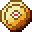 Fateful Coin (5 luminite bars, 5 of each fragment, 100 tokens, Ancient Manipulator).

| | Normal | Expert | Master |
|---|---|---|---|
| Life (one player) | 480,000 | 672,000 | 856,800 |
| Contact damage | 110 | 165 | 247 |
| Defense | 50 | 50 | 50 |

| Hit before defense | Normal | Expert | Master |
|---|---|---|---|
| Chips, pockets, cards | 96 | 148 | 211 |
| Star die, pot | 120 | 186 | 264 |
| Reels, ball | 125 | 193 | 275 |
| Beam | 130 | 201 | 286 |

Measured kill times (immortal player, near perfect aim, so a real fight takes longer):

| Equipment | Normal | Expert | Master |
|---|---|---|---|
| Celestial set only, Infinity Slot | 221 s | 327 s | 415 s |
| Everything upgraded, with All In | 62 s (Infinity Slot, 5 accessories) | 80 s (Eye of Fortune, 6) | 90 s (Eye of Fortune, 6) |
| Zenith, Solar set, 6 accessories | not measured | 44 s | 52 s |

The wheel over her crown stops on an icon before every attack. Attacks come from a shuffled deck, never the same one twice in a row.

| Attack | Phase | How to survive |
|---|---|---|
| Ring Toss | 1+ | The pockets fly out in turning rings and come back. Slip between them both ways |
| Fate Dice | 1+ | Star dice fall on marked spots. The number on the die is how many pairs of chips fly out |
| Three Reels | 1+ | Columns stop one kind after another. Clover is safe, everything else erupts |
| Gaze | 1+ | A beam sweeps the way the arrows point; two beams in phase 2, three in phase 3 |
| Card Curtain | 1+ | Walls of cards from both sides with a gap that moves |
| Pot of Gold | 2+ | Pulls you in and swallows chips, then pays out in three rings |
| Runaway Ball | 2+ | A steel ball bounces in a neon frame; its path is drawn ahead |
| Last Bet | once, at 8% | She is helpless for 5 s. The odds of a jackpot start at 10% and rise 12 points per 1% of her life you take, up to 90%. Jackpot: stunned for about 3 s, +50% damage taken. Otherwise 6 s of fire from every ring |

Phases: 1 above 66% life, 2 from 66% to 33%, 3 below 33% (blindfold torn, 20% faster).

**Drops (Normal):** one of Ophanim, Dice of Destiny or Eye of Fortune; 8-12 Fate Shards; 300-400 tokens; 4-6 High Roller Crates; mask (1/7).
**Treasure bag (Expert):** the same weapons, 10-15 Fate Shards, 400-500 tokens, 5-7 High Roller Crates, Fortuna's Blindfold, mask (1/7).
**Always:** trophy (1/10). **Master:** relic. Each weapon can also be made from 18 Fate Shards at the Upgrade Machine.

---

## High Stakes Night

A raid by the card army on the surface.

- **When:** hardmode, after a mechanical boss. Each nightfall has a 1 in 10 chance.
- **Marked Invitation:** starts it at once, at night. 5 Souls of Night, 5 silk and 30 tokens (Mythril Anvil), or 60 tokens from the Prize Cashier.
- **Goal:** defeat 100 army enemies, plus 25 for each player after the first. The bar is at the bottom right.
- **End:** beat the Guard Captain, or wait for dawn. Progress is saved with the world.
- Can be switched off in the [settings](#page-settings).

| Enemy | Relative weight |
|---|---|
| Card Soldier | 1.4 |
| Royal Guard | 0.8 |
| Chip Slime | 0.6 |
| Roulette Wraith | 0.6 |
| Slot Mimic | 0.08 |

Card Soldiers and Chip Slimes have four times the life, 2.5 times the damage and +14 defense during the raid.

### Kinds of raid
| Raid | Chance | Army and captain | Reward |
|---|---|---|---|
| High Stakes Night | 50% | as above | as below |
| Double or Nothing | 25% | +50% life, +15% damage, glow red | Captain drops crates and tokens twice |
| Golden Night | 25% | +20% life, plated in gold, more Slot Mimics | Four times the coins, a token from every fourth kill |

### Guard Captain
A giant Royal Guard that arrives when the goal is reached, with the same shield and spade volley.

| Life | Damage | Defense | Coins |
|---|---|---|---|
| 4,500 | 85 | 38 | 5g |

**Drops:** 2-3 High Roller Crates, 60-90 tokens, Royal Flush (1/3), Vault Key (1/2).

---

## NPCs

### The Gambler (town NPC)
Moves in when the world has a surface casino or a player carries a Loyalty Token, and a house is free. Loves the underground and the Tax Collector, likes the forest and the Merchant, dislikes snow and the Nurse. Fights with thrown cards.

Sells the Casino Blueprint, [crates](#page-crates) at prices that follow the world's progress, the Golden Chip (8g, after Skeletron), Sunglasses and Top Hat (1g each). Names: Lucky Lou, Vegas Vinnie, Ace, Dice Dan, Chip, Big Tony, Roulette Ray, Jackpot Jim.

### Prize Cashier
Sells prizes for Loyalty Tokens and gives the [daily challenges](#games--daily-challenges).

| Prize | Price |
|---|---|
| Gambler's Handbook | 10s |
| Scratch Card / Platinum Scratch Card (hardmode) | 50s / 5g |
| Lucky Crate / High Roller Crate (hardmode) | 75 / 150 tokens |
| Golden Chip (after Skeletron) | 150 tokens |
| Gamblorghini | 200 tokens |
| Golex | 150 tokens |
| Chip Chain | 120 tokens |
| Dealer's Visor (hardmode) | 250 tokens |
| High Roller's Ring (hardmode) | 400 tokens |
| White Fedora / Tuxedo / Spats | 60 / 80 / 60 tokens |
| Top Hat / Tuxedo Shirt / Tuxedo Pants | 25 / 40 / 40 tokens |
| Sunglasses / Gold Chandelier / Disco Ball | 30 / 20 / 30 tokens |

### Bartender
Runs the Sic Bo game and sells Ale (5s), Sake (8s), Fruit Juice (10s), Lemonade (10s) and Cream Soda (15s).

### Croupier and Blackjack Dealer
Stand at their tables. "How to play" explains the rules.

### Entertainers and guests
- **Showgirl** and **Pole Dancer** perform in the cabaret.
- **Guests** (12 per casino) stroll between the tables, each with a generated look.
- **Togi**, a gambling streamer, plays the upstairs slots of the surface casino on one visit in three.
- **Casino visitors** step out of the surface casino for some air.

### Concierge
Stands by the right wall of the ground floor. Sells VIP levels, the Penthouse Key and the casino's furniture. See [The club](#page-club).

### Poker Dealer
Runs the Hold'em table on the bar floor and the Coin Duel table in the cabaret.

---

## All items

Weapons, armour and accessories have their own pages: [Weapons](#page-weapons), [Armour](#page-armor), [Accessories](#page-accessories).

| | Item | Use | Source |
|---|---|---|---|
|  | Casino Blueprint | Builds or moves the surface casino | Starting item, 25 Wood (Work Bench), the Gambler |
|  | Gambler's Handbook | In-game guide | Starting item, Prize Cashier (10s) |
|  | Loyalty Token | Casino currency and crafting material | Betting, enemies, bosses, challenges |
|  | Lucky Crate | Opens for a random prize | See [Crates](#page-crates) |
|  | High Roller Crate | Better odds | See [Crates](#page-crates) |
|  | Scratch Card | Scratch game, prizes up to 50g | Prize Cashier (50s) |
|  | Platinum Scratch Card | Scratch game | Prize Cashier (5g, hardmode) |
|  | Golden Chip | Summons The Wild Card at night | 10 gold or platinum bars, 5 bones, 50 tokens (Work Bench); the Gambler (8g) or Prize Cashier (150 tokens) after Skeletron |
|  | Marked Invitation | Starts High Stakes Night, at night in hardmode after a mechanical boss | 5 Souls of Night, 5 silk, 30 tokens (Mythril Anvil); Prize Cashier, 60 tokens |
|  | Vault Key | Summons The Pit Boss in the High Rollers casino, after a mechanical boss | 6 hallowed bars, 3 Souls of Fright, Might or Sight, 60 tokens (Mythril Anvil); Guard Captain (1/2) |
|  | Vault Bullion | Material of the Pit Boss set | The Pit Boss |
| 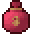 | Treasure Bag (The Wild Card) | Expert loot | The Wild Card |
|  | Treasure Bag (The Pit Boss) | Expert loot | The Pit Boss |
| 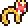 | Chip Chain | Grappling hook: two hooks, range 400 pixels (25 tiles) | Prize Cashier, 120 tokens |
|  | Gamblorghini | Minecart mount | Prize Cashier, 200 tokens; legendary crates |
|  | Lucky Coin Slot (Master) | Mini Slot pet. One spin in eight hits 777 and gives a basic potion buff for two minutes | The Wild Card (1/4) |
|  | Wild Card Mask | Vanity | The Wild Card (1/7), crates |
| 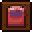 | The Wild Card Trophy | Decoration | The Wild Card (1/10) |
| 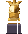 | The Wild Card Relic (Master) | Decoration | The Wild Card |
|  | Pit Boss Mask | Vanity | The Pit Boss (1/7) |
|  | The Pit Boss Trophy | Decoration | The Pit Boss (1/10) |
|  | The Pit Boss Relic (Master) | Decoration | The Pit Boss |
|  | Casino Door | Development item | Not obtainable in normal play |

Banners exist for all eight regular enemies.

---

## Settings and multiplayer

### Server settings (Casino World)
| Setting | Default | Effect |
|---|---|---|
| Gambling enabled | On | Off: tables, slots, scratch cards and crates take no bets. Casinos, NPCs and gear stay |
| Video slot payout | 1.00 | Multiplies every video slot win (0.80-1.10) |
| Announcements | On | Chat messages about the High Rollers casino |
| High Stakes Night | On | Allows the raid |

### Client settings (Casino World (client))
| Setting | Default | Effect |
|---|---|---|
| Pot meter | HUD | HUD (draggable) or under the player |
| Screen effects | On | All screen effects at once |
| Screen shake | On | Shaking on explosions and boss attacks |
| Flashes | On | Flashing light, win light shows, the Triple Jackpot lights |
| Camera zoom | On | Zoom kicks and the camera leaning towards bosses on big moments, the zoom on a Triple Jackpot |
| Hit stop and slow motion | On | Short freezes on heavy hits and slow motion on boss phase changes (single player only) |
| Particle amount | Normal | Low, Normal or High: how many sparks, smoke puffs, shards and coins effects spawn |

### Controls
| Key | Default |
|---|---|
| All In (Gambler) | V |
| Enter or leave the casino | Up (W) |

If All In has no key, the meter, weapon tooltips and chat say so.

### Multiplayer
- Casinos run as SubworldLibrary subworlds.
- Roulette spins are rolled by the server.
- Hold'em hands are dealt by the server; a client only gets its own cards. Coin duels are tossed by the server.
- Statistics, achievements and VIP levels belong to each character; the penthouse is shared per world.
- A crash or a lost connection in the middle of a round costs nothing that was saved: open stakes, wins already rolled and items inside machines come back on the next join. Chips already in a poker pot are lost, and so are free spins still to come after a crash (the bet comes back).
- The leaderboard of biggest wins is shared per world.
- The High Stakes Night goal grows with the number of players.

### Other mods
Boss Checklist is supported. SubworldLibrary is required.

---

## Development

### Building
`dotnet build` with the game closed, or Workshop > Develop Mods > Build + Reload. .NET 8 SDK, pinned by `global.json`. `lib/SubworldLibrary.dll` is a compile-time reference only and is not packed into the mod.

### Layout
| Folder | Contents |
|---|---|
| `Common/Gambler` | Damage class, Jackpot / Bust roll, Pot, All In, Fates, meter |
| `Common/Club` | Statistics, achievements, contracts, Ledger, VIP levels |
| `Common/Games` | Roulette, poker, coin duel, blackjack, slots, video slots, Sic Bo, scratch cards, challenges, leaderboard |
| `Common/Crates` | Crate loot, opening, world generation, fishing |
| `Common/Upgrades` | Upgrade Machine and armour evolution |
| `Common/Systems` | Travel, world entrances, config, High Stakes Night, Boss Checklist |
| `Common/Effects` | Shared particles, boss titles, Triple Jackpot |
| `Content/Items`, `NPCs`, `Projectiles`, `Tiles` | Game content; each sprite sits next to its class |
| `Content/Subworlds` | Casino interiors |
| `Localization` | All text |

### Commands
| Command | Effect |
|---|---|
| `/casinohere` | Builds the surface casino where you stand |
| `/casinovip` | Builds the High Rollers entrance where you stand |

### Keeping these docs correct
Numbers are copied from the code. When you change a value, update the matching page: weapons and armour in `Content/Items`, odds in `GamblerPlayer` and `GamblerPot`, crates in `CrateLoot`, upgrades in `GamblerUpgrades` and `ArmorEvolution`, bosses in `Content/NPCs/Boss`, the raid in `HighStakesNight`, contracts in `ContractBook`, Fates in `FatePlayer`. Every game that takes a stake must report what it owes in `Owed` (see `Escrow`).
