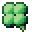
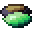
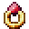
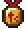
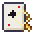
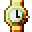

# Accessories

| | Accessory | Effect | Source |
|---|---|---|---|
|  | Four-Leaf Clover | +2 Luck | Surface casino jackpots, crates |
|  | Ace Up the Sleeve | +3% jackpot chance | Surface casino jackpots, crates |
|  | House Edge (Expert) | +5% jackpot chance; the first bust every 10 s becomes a normal hit | The Wild Card treasure bag |
|  | Gambler Emblem | +15% Gambler damage | Wall of Flesh (1/5), or any of the Warrior, Ranger, Sorcerer or Summoner emblems and 30 tokens at a Tinkerer’s Workshop, or shimmering the Summoner Emblem |
|  | Dealer's Visor | +2 Luck, +3% jackpot chance | Prize Cashier, 250 tokens (hardmode) |
|  | High Roller's Ring | +2 Luck, +8% Gambler damage | Prize Cashier, 400 tokens (hardmode), crates |
|  | Martingale Medallion | +2% jackpot chance for every hit without a jackpot, up to 75% in total; a jackpot resets it | Hardmode crates |
|  | Insider Info (Expert) | +6% jackpot chance, the Pot fills 30% faster | The Pit Boss treasure bag |
|  | Royal Flush Wings | Flight (time 160, speed 8), +1 Luck | 20 Souls of Flight, 10 ectoplasm, 400 tokens (Mythril Anvil); legendary crates |
|  | Golex | Shows movement speed (works from the inventory) | Prize Cashier, 150 tokens; crates |
