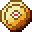

# Bosses

## The Wild Card
A flying jester made of playing cards. Tier: after Skeletron, before the Wall of Flesh (Boss Checklist 5.5).

**Summon:**  Golden Chip, at night, outside the casinos. It leaves at dawn.

| | Normal | Expert | Master |
|---|---|---|---|
| Life (one player) | 9,500 | 15,200 | 19,380 |
| Contact damage | 40 | 64 | 96 |
| Defense | 14 | 14 | 14 |

| Phase | Life | Attacks |
|---|---|---|
| Card Tricks | 100-60% | **Deal:** fans of cards. **Shell Game:** it hides in one of three shuffling cards; the real one glows at the start. Fakes burst into spades, and when revealed the boss is stunned and takes 50% more damage. **52 Pickup:** telegraphed columns of falling cards |
| Roll the Dice | 60-25% | Two dice land and their sum picks an attack: snakes of chips (2), bouncing dice (3-6), Lucky Seven (7), dashes (8-11) or giant rolling dice (12). Doubles repeat the next attack faster |
| All In | below 25% | Spiral chip barrages between faster tricks, 25% faster overall |

**Drops (Normal):** one of Jackpot Lever, Dealer's Hand or Wheel of Fortune; 80-120 tokens; 2-3 Lucky Crates; Golden Chip (1/3); mask (1/7).
**Treasure bag (Expert):** the same weapons, 120-180 tokens, 3-4 Lucky Crates, Golden Chip (1/2), House Edge, mask (1/7).
**Always:** trophy (1/10). **Master:** relic, Lucky Coin Slot pet (1/4).

## The Pit Boss
A mob-boss croupier on a flying roulette wheel. Tier: after a mechanical boss, before Plantera (Boss Checklist 9.5). Fought inside the High Rollers casino.

**Summon:**  Vault Key in the High Rollers casino.

| | Normal | Expert | Master |
|---|---|---|---|
| Life (one player) | 30,000 | 42,000 | 53,549 |
| Contact damage | 64 | 102 | 153 |
| Defense | 26 | 26 | 26 |

| Hit before defense | Normal | Expert | Master |
|---|---|---|---|
| Chips | 56 | 84 | 120 |
| Bet column | 72 | 108 | 156 |
| Gold bar | 64 | 96 | 138 |
| Giant coin | 90 | 136 | 198 |

Attacks come from a shuffled deck: each one once, then it is shuffled again, and never the same one twice in a row.

| Attack | Phase | How to survive |
|---|---|---|
| Chip Spray | 1+ | Arcs of bouncing chips; every second chip leads you, so change direction |
| Place Your Bets | 1+ | The whole hall splits into red columns with diamonds and black columns with spades. The ball rolls to the winner and the winning colour glows for 0.75 s before it erupts floor to ceiling. Stand in the losing colour |
| Gold Rush | 1+ | Bars fall from the ceiling. Follow the lines and landing marks |
| Security | 1+ | Calls Royal Guards, at most two alive |
| Cash Out | 1+ | Two or three charges along a marked lane that locks about half a second ahead. Leave the lane vertically |
| Wheel Barrage | 2+ | Rings of chips with a gap near you; at a distance they close up into a fan |
| Double or Nothing | 2+ | A giant coin follows you. Its lane turns green for tails (safe, the boss is stunned for 2 s and takes 25% more damage) or red for heads (slam, shockwave and bouncing coins) |

Phases: 1 above 55% life, 2 from 55% to 25%, 3 below 25% (25% faster, bets twice in a row).

**Drops (Normal):** one of Croupier's Rake, Bank Breaker or Vault Buster; 150-220 tokens; 10-14 Vault Bullion; 2-3 High Roller Crates; mask (1/7).
**Treasure bag (Expert):** the same weapons, 200-280 tokens, 13-18 Vault Bullion, 3-4 High Roller Crates, Insider Info, mask (1/7).
**Always:** trophy (1/10). **Master:** relic.

## Fortuna, the Last Wheel
A porcelain goddess inside three turning casino rings. Tier: after the Moon Lord (Boss Checklist 19). Fought anywhere in the main world.

**Summon:**  Fateful Coin (5 luminite bars, 5 of each fragment, 100 tokens, Ancient Manipulator).

| | Normal | Expert | Master |
|---|---|---|---|
| Life (one player) | 480,000 | 672,000 | 856,800 |
| Contact damage | 110 | 165 | 247 |
| Defense | 50 | 50 | 50 |

| Hit before defense | Normal | Expert | Master |
|---|---|---|---|
| Chips, pockets, cards | 96 | 148 | 211 |
| Star die, pot | 120 | 186 | 264 |
| Reels, ball | 125 | 193 | 275 |
| Beam | 130 | 201 | 286 |

Measured kill times (immortal player, near perfect aim, so a real fight takes longer):

| Equipment | Normal | Expert | Master |
|---|---|---|---|
| Celestial set only, Infinity Slot | 221 s | 327 s | 415 s |
| Everything upgraded, with All In | 62 s (Infinity Slot, 5 accessories) | 80 s (Eye of Fortune, 6) | 90 s (Eye of Fortune, 6) |
| Zenith, Solar set, 6 accessories | not measured | 44 s | 52 s |

The wheel over her crown stops on an icon before every attack. Attacks come from a shuffled deck, never the same one twice in a row.

| Attack | Phase | How to survive |
|---|---|---|
| Ring Toss | 1+ | The pockets fly out in turning rings and come back. Slip between them both ways |
| Fate Dice | 1+ | Star dice fall on marked spots. The number on the die is how many pairs of chips fly out |
| Three Reels | 1+ | Columns stop one kind after another. Clover is safe, everything else erupts |
| Gaze | 1+ | A beam sweeps the way the arrows point; two beams in phase 2, three in phase 3 |
| Card Curtain | 1+ | Walls of cards from both sides with a gap that moves |
| Pot of Gold | 2+ | Pulls you in and swallows chips, then pays out in three rings |
| Runaway Ball | 2+ | A steel ball bounces in a neon frame; its path is drawn ahead |
| Last Bet | once, at 8% | She is helpless for 5 s. The odds of a jackpot start at 10% and rise 12 points per 1% of her life you take, up to 90%. Jackpot: stunned for about 3 s, +50% damage taken. Otherwise 6 s of fire from every ring |

Phases: 1 above 66% life, 2 from 66% to 33%, 3 below 33% (blindfold torn, 20% faster).

**Drops (Normal):** one of Ophanim, Dice of Destiny or Eye of Fortune; 8-12 Fate Shards; 300-400 tokens; 4-6 High Roller Crates; mask (1/7).
**Treasure bag (Expert):** the same weapons, 10-15 Fate Shards, 400-500 tokens, 5-7 High Roller Crates, Fortuna's Blindfold, mask (1/7).
**Always:** trophy (1/10). **Master:** relic. Each weapon can also be made from 18 Fate Shards at the Upgrade Machine.
