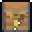
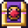

# Crates

 **Lucky Crate** and  **High Roller Crate**. Right-click to open: a reel spins and stops on the prize. Contents follow the world's progress at the moment of opening.

| Rarity | Lucky | High Roller | Contents |
|---|---|---|---|
| Common (blue) | 58% | 45% | Supplies: potions, coins, tokens, materials |
| Uncommon (purple) | 25% | 30% | Useful vanilla gear, coins, tokens |
| Rare (pink) | 10% | 15% | Gambler accessories, luxury, vanity |
| Epic (red) | 6% | 8% | Gambler weapons, and Gambler armour before hardmode |
| Legendary (gold) | 1% | 2% | A golden Gambler weapon, the Gamblorghini, wings or platinum |

**Pity:** the tenth crate in a row without Rare or better gives Rare. The 25th without Epic or better gives Epic. The 80th without Legendary gives Legendary. The counters are saved with the character.

**Golden weapons** deal 10% more damage and have a gold look. The bonus stacks with reforges and upgrades.

## Notable contents
| Stage | Rare | Epic | Legendary |
|---|---|---|---|
| Early | Four-Leaf Clover, Ace Up the Sleeve, Golex, Top Hat, Sunglasses | Loaded Dice, Deck of Cards, High Roller, Gambler set | Golden versions, Gamblorghini, 1p |
| After Skeletron | As early, with the Wild Card Mask and Golden Chip instead of the vanity | Also Jackpot Lever, Dealer's Hand, Wheel of Fortune | Golden versions, Gamblorghini, 1-2p |
| Hardmode | Clover, Ace, Golex, Titan Glove, High Roller's Ring, Martingale Medallion | Snake Eyes, Royal Flush, Jackpot Cannon | Golden versions, Gamblorghini, 2-3p |
| After Plantera | Destroyer Emblem, Ring, Medallion and the base accessories | Ace of Spades, Doubling Dice, Roulette Revolver | Golden versions, Royal Flush Wings, Gamblorghini, 3-5p |
| After the Moon Lord | Celestial Shell, Ring, Medallion and the base accessories | Stardust Deck, Meteor Dice, Infinity Slot | Golden versions, Royal Flush Wings, Gamblorghini, 8-12p |

## Where to find them
- In newly generated worlds, every vanilla chest holds a Lucky Crate. Gold and locked dungeon chests hold two, one time in four. Chests in existing worlds are left alone.
- Lucky Crates lie on cave floors, and High Roller Crates are scattered through the caverns when the High Rollers casino opens.
- Fishing: a crate catch becomes a casino crate 1 time in 5 (in hardmode a third of those are High Roller). Any other catch is a Lucky Crate 1 time in 80.
- Drops from casino [enemies](enemies.md) and [bosses](bosses.md), daily challenges, the Fortune Wheel.
- Prize Cashier: 75 tokens (Lucky), 150 tokens (High Roller, hardmode).
- The Gambler NPC:

| Stage | Lucky Crate | High Roller Crate |
|---|---|---|
| Early | 2g 50s | |
| After Skeletron | 3g 50s | |
| Hardmode | 7g | 8g |
| After Plantera | 15g | 17g |
| After the Moon Lord | 48g | 52g |
