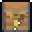
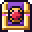
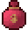
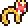
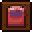

# All items

Weapons, armour and accessories have their own pages: [Weapons](weapons.md), [Armour](armor.md), [Accessories](accessories.md).

| | Item | Use | Source |
|---|---|---|---|
|  | Casino Blueprint | Builds or moves the surface casino | Starting item, 25 Wood (Work Bench), the Gambler |
|  | Gambler's Handbook | In-game guide | Starting item, Prize Cashier (10s) |
|  | Loyalty Token | Casino currency and crafting material | Betting, enemies, bosses, challenges |
|  | Lucky Crate | Opens for a random prize | See [Crates](crates.md) |
|  | High Roller Crate | Better odds | See [Crates](crates.md) |
|  | Scratch Card | Scratch game, prizes up to 50g | Prize Cashier (50s) |
|  | Platinum Scratch Card | Scratch game | Prize Cashier (5g, hardmode) |
|  | Golden Chip | Summons The Wild Card at night | 10 gold or platinum bars, 5 bones, 50 tokens (Work Bench); the Gambler (8g) or Prize Cashier (150 tokens) after Skeletron |
|  | Marked Invitation | Starts High Stakes Night, at night in hardmode after a mechanical boss | 5 Souls of Night, 5 silk, 30 tokens (Mythril Anvil); Prize Cashier, 60 tokens |
|  | Vault Key | Summons The Pit Boss in the High Rollers casino, after a mechanical boss | 6 hallowed bars, 3 Souls of Fright, Might or Sight, 60 tokens (Mythril Anvil); Guard Captain (1/2) |
|  | Vault Bullion | Material of the Pit Boss set | The Pit Boss |
|  | Treasure Bag (The Wild Card) | Expert loot | The Wild Card |
|  | Treasure Bag (The Pit Boss) | Expert loot | The Pit Boss |
|  | Chip Chain | Grappling hook: two hooks, range 400 pixels (25 tiles) | Prize Cashier, 120 tokens |
|  | Gamblorghini | Minecart mount | Prize Cashier, 200 tokens; legendary crates |
|  | Lucky Coin Slot (Master) | Mini Slot pet. One spin in eight hits 777 and gives a basic potion buff for two minutes | The Wild Card (1/4) |
|  | Wild Card Mask | Vanity | The Wild Card (1/7), crates |
|  | The Wild Card Trophy | Decoration | The Wild Card (1/10) |
|  | The Wild Card Relic (Master) | Decoration | The Wild Card |
|  | Pit Boss Mask | Vanity | The Pit Boss (1/7) |
|  | The Pit Boss Trophy | Decoration | The Pit Boss (1/10) |
|  | The Pit Boss Relic (Master) | Decoration | The Pit Boss |
|  | Casino Door | Development item | Not obtainable in normal play |

Banners exist for all eight regular enemies.
