# Weapons

All weapons deal Gambler damage and can be upgraded at the [Upgrade Machine](upgrade-machine.md). Use time is in ticks.

## Pre-hardmode
| | Weapon | Damage | Use time | Knockback | Source |
|---|---|---|---|---|---|
| 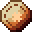 | Lucky Penny | 10 | 20 | 2 | 8 copper or tin bars, 5 tokens (Anvil) |
| 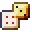 | Loaded Dice | 21 | 24 | 4 | Surface casino jackpots, crates |
|  | Deck of Cards | 9 x3 | 20 | 1.5 | Surface casino jackpots, crates, Card Soldier (1/80) |
|  | High Roller | 27 | 26 | 3 | Surface casino jackpots, crates |
| 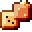 | Hellfire Dice | 24 x2 | 26 | 4 | 15 hellstone bars, 30 tokens (Anvil) |
| 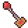 | Jackpot Lever | 26 | 26 | 7 | The Wild Card, crates after Skeletron |
|  | Dealer's Hand | 8 | 10 | 1 | The Wild Card, crates after Skeletron |
| 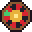 | Wheel of Fortune | 18 | 22 | 4 | The Wild Card, crates after Skeletron |

## Hardmode
| | Weapon | Damage | Use time | Knockback | Source |
|---|---|---|---|---|---|
|  | Snake Eyes | 36 | 24 | 5 | High Rollers jackpots, crates, Slot Mimic |
|  | Royal Flush | 16 x5 | 24 | 2 | High Rollers jackpots, crates, Slot Mimic, Royal Guard (1/60), Guard Captain (1/3) |
| 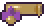 | Jackpot Cannon | 58 | 30 | 6 | High Rollers jackpots, crates, Slot Mimic |
| 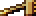 | Croupier's Rake | 34 x3 | 24 | 4 | The Pit Boss |
|  | Bank Breaker | 25 x5 | 34 | 3 | The Pit Boss |
|  | Vault Buster | 56 | 30 | 6 | The Pit Boss |

## After Plantera
| | Weapon | Damage | Use time | Knockback | Source |
|---|---|---|---|---|---|
|  | Ace of Spades | 60 | 24 | 3 | High Rollers jackpots, crates |
| 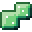 | Doubling Dice | 46 | 28 | 4 | High Rollers jackpots, crates |
| 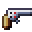 | Roulette Revolver | 30 | 16 | 2 | High Rollers jackpots, crates |

## After the Moon Lord
| | Weapon | Damage | Use time | Knockback | Source |
|---|---|---|---|---|---|
|  | Stardust Deck | 115 | 16 | 3 | High Rollers jackpots, crates |
| 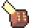 | Meteor Dice | 220 | 24 | 6 | High Rollers jackpots, crates |
| 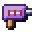 | Infinity Slot | 110 x2 | 12 | 3 | High Rollers jackpots, crates |

## What they do
| Weapon | Behaviour | Against walls and floors |
|---|---|---|
| Lucky Penny | A coin flip: heads splits into two half-damage coins on its first hit | Clinks and sparks |
| Loaded Dice | Bouncing die, pierces 3 | Up to 3 bounces; each rolls 1-6 and sets the damage (x0.75 to x1.25, 1.0 on average) |
| Deck of Cards | Fan of three cards | Sticks for about 1.5 s as a trap for half damage |
| High Roller | Ricochets to another enemy after a hit | One bank shot, turning to an enemy within a 45 degree cone |
| Hellfire Dice | Two dice, set enemies on fire | Two bounces, each leaves an ember for 25% damage |
| Jackpot Lever | Melee. Every third hit spins: fire, 6 healing, an explosion or Midas | |
| Dealer's Hand | Card stream, every eighth throw is a fan of seven | One skip, then 60% damage |
| Wheel of Fortune | Boomerang that explodes red or black when it returns; one at a time | One burst per throw: red 50% damage, black 35% with double knockback |
| Snake Eyes | Bouncing die that explodes | After its bounces it sticks as a mine, armed for about half a second |
| Royal Flush | Five homing cards; all five in one enemy complete the flush (bonus blast, 120% of a card's damage) | Burns up |
| Jackpot Cannon | Heavy chip, ricochets to two more enemies | Pays out two coins (20% each) |
| Croupier's Rake | Three rolling chips, pierce up to 3 hits | Raked back once for half damage, can hit the same enemy again |
| Bank Breaker | Five-chip shotgun | Each chip shatters into a coin (35%) |
| Vault Buster | Lobbed gold bar that bursts into six coins (30% each) | Slam blast, 40% damage |
| Ace of Spades | Homing spectral card, up to 3 hits | Passes through walls |
| Doubling Dice | Splits into two half-damage dice on its first hit | Splits too, for 70% of the usual halves |
| Roulette Revolver | Every sixth shot is a golden round with triple damage | The golden round explodes, 40% damage |
| Stardust Deck | Bursts into three homing cards (35% each) | Bursts too, for 70% of that |
| Meteor Dice | Calls a burning die onto the cursor; the impact and the large explosion each hit for full damage | Leaves three embers (1/8 damage) |
| Infinity Slot | Two reel symbols per shot; rarer symbols hit harder | See below |

### Infinity Slot symbols
| Symbol | Damage | Against walls |
|---|---|---|
| Cherry | x0.7 | Splatters |
| Lemon | x0.85 | Splatters |
| Bell | x1.0 | Ringing blast, 35% |
| Clover | x1.15 | Bounces once |
| Bar | x1.5 | Two coins, 25% each |
| Seven | x1.8 | Explosion, 50% |
| Diamond | x2.2 | Three coins, 35% each |

## Estimated single-target DPS
Model values with typical set Luck and no reforges, upgrades or All In.

| Tier | Weapons | Vanilla weapons of the stage (average) |
|---|---|---|
| Early pre-hardmode | 59-70 | 65 |
| After Skeletron | 71-77 | 76 |
| Early hardmode | 130-151 | 134 |
| Pit Boss | 171-182 | |
| After Plantera | 195-205 | 193 |
| After the Moon Lord | about 1200 | 1186 |
| Fortuna | about 1,400 | |

### Measured in game
30 s on one large target that stands still, 50 defense (Fortuna's), perfect aim. One run each, about 10% noise.

| Weapon | Celestial set only | +10, Lucky, golden, 5 accessories | the same with All In | 6 expert accessories | the same with All In |
|---|---|---|---|---|---|
| Stardust Deck | 1,530 | 5,990 | 7,350 | 7,280 | 9,460 |
| Meteor Dice | 2,720 | 7,990 | 9,370 | 9,130 | 12,710 |
| Infinity Slot | 2,940 | 8,130 | 10,440 | 10,850 | 15,520 |
| Ophanim | 2,580 | 8,490 | 11,280 | 11,310 | 13,790 |
| Dice of Destiny | 2,390 | 7,910 | 8,520 | 8,320 | 11,900 |
| Eye of Fortune | 2,370 | 8,240 | 12,300 | 11,120 | 14,470 |

Vanilla in the same test with the best reforges and six accessories: Zenith (Solar set) 22,970, S.D.M.G. (Vortex set, chlorophyte bullets) 5,430.

## Fortuna's weapons
All drop from Fortuna or are made from 18 Fate Shards at the Upgrade Machine.

| | Weapon | Damage | Use time | Effect |
|---|---|---|---|---|
| 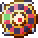 | Ophanim | 132 | held | A wheel stays at the cursor, saws every 8 ticks and throws a homing chip three times a second (50%) |
| 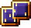 | Dice of Destiny | 190 | 22 | Two star dice that burst (65%); doubles burst wider (110%), a total of seven releases homing chips |
| 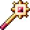 | Eye of Fortune | 132 | 9 | Instant piercing ray; every eighth shot is a triple |
